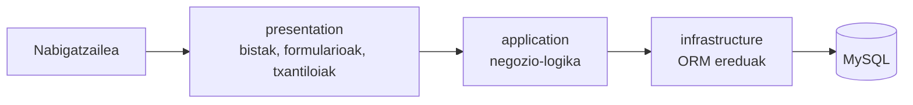

# PyJangela

Ikastetxe bateko **jangela** kudeatzeko web aplikazioa: menuak, erreserbak, ordainketak eta komensalak.
Laravel/PHP-n idatzitako aplikazio baten **migrazioa** da, Python eta Django-ra.

Hezkuntza-proiektua da: helburua kodea argia eta erraz azaltzeko modukoa izatea da,
gehiegizko ingeniaritzarik gabe. Negozio-arauak eta erabilera-kasuak ez dira aldatu migrazioan.

## Zer egiten du?

Hiru rol daude, eta bakoitzak bere dashboard-a du:

| Rola | Zer egin dezake |
|---|---|
| **Ikaslea** | Menua kontsultatu, ordainketak ikusi. Egoiliarra bada, ikasturte osorako erreserba konfiguratzen du; bestela, egun jakinetarako erreserbak egiten ditu |
| **Irakaslea** | Menua kontsultatu, erreserba puntualak egin eta ezeztatu, ordainketak ikusi |
| **Sukaldea** | Menuak kudeatu (estandarra eta beganoa), eguneko komensalak eta hurrengo egunetako estatistikak ikusi |

Xehetasunak: [erabilera-kasuak](docs/erabilera-kasuak.md).

## Teknologiak

- **Backend**: Python, Django, MySQL 8.4
- **Frontend**: HTML, Bootstrap 5, JavaScript (`fetch` + promesak; jQuery datepicker-erako soilik)
- **Hedapena**: Docker Compose (Apache + mod_wsgi eta MySQL) · **CI**: GitHub Actions

## Arkitektura, laburrean



Geruzetan antolatuta, baina laua: **bista → zerbitzua → ORM eredua**, Repository edo DDD gabe.
Zergatik eta nola: [arkitektura](docs/arkitektura.md).

## Abian jarri

Docker-ekin, errepoaren erroan (`.env.docker` sortu ondoren):

```bash
docker compose up --build
```

Aplikazioa: <http://localhost:8080>. Urrats guztiak (eta Docker gabeko instalazioa): [instalazioa](docs/instalazioa.md).

## Dokumentazioa

[`docs/`](docs/README.md) karpetan dago, euskaraz:

- [Arkitektura](docs/arkitektura.md) — geruzak, MVC/MVT eta non balidatzen den zer
- [UML diagrama](docs/uml-diagrama.md) — domeinuko entitateak eta erlazioak
- [Erabilera-kasuak](docs/erabilera-kasuak.md) — UC01–UC20 rolaren arabera
- [Segurtasuna](docs/segurtasuna.md) — XSS, CSRF, SQL injection, rolak eta sekretuak
- [Instalazioa](docs/instalazioa.md) — klasikoa eta Docker bidezkoa
- [Garapen-plana](docs/garapen-plana-gantt.md) — Gantt diagrama

## Egitura

```text
pyjangela/
├── docs/                 # dokumentazioa
├── docker-compose.yml
└── web/                  # Django proiektua
    ├── config/           # ezarpenak eta URL nagusiak
    └── jangela/          # app bakarra: domain, application, infrastructure, presentation
```

Garapenaren egoera: [GitHub Projects](https://github.com/users/lopezibon-dev/projects/1).
