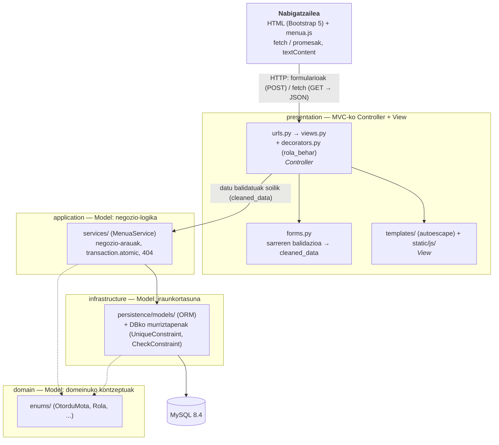

# Arkitektura

PyJangela Django proiektu bat da, app bakarrarekin (`jangela`). Kodea **geruzetan** antolatuta dago,
baina arkitektura **laua** da: bista → zerbitzua → ORM eredua. Ez dago Repository patroirik,
ez DDD agregaturik, ez domeinuko entitate bereizirik: Django-ren ORM ereduak dira entitateak.

## Geruzak



| Geruza | Karpeta | Ardura |
|---|---|---|
| presentation | [`web/jangela/presentation/`](../web/jangela/presentation/) | Eskaera jaso, formularioarekin balidatu, zerbitzuari deitu, txantiloia edo JSON-a itzuli |
| application | [`web/jangela/application/services/`](../web/jangela/application/services/) | Negozio-arauak; ORM-a zuzenean erabiltzen du |
| domain | [`web/jangela/domain/enums/`](../web/jangela/domain/enums/) | Enum hutsak `(str, Enum)`: balioen iturri bakarra |
| infrastructure | [`web/jangela/infrastructure/persistence/models/`](../web/jangela/infrastructure/persistence/models/) | ORM ereduak (bat fitxategiko) eta DBko murriztapenak |

## MVC eta MVT

Django-k **MVT** deitzen dio (Model–View–Template). Hemen honela lotzen dira MVC-ko osagaiekin:

| MVC | Django (MVT) | PyJangela-n |
|---|---|---|
| Controller | *View* (funtzioa) + `urls.py` | `views.py`, `urls.py`, `decorators.py` |
| View | *Template* | `templates/` (`base.html` + `ikaslea/`, `irakaslea/`, `sukaldea/`) eta `static/js/` |
| Model | *Model* | `application/` + `domain/` + `infrastructure/` |

Hau da: MVC-ko **Model**-a hiru geruzatan banatuta dago, eta Django-ren *view*-ak **Controller** lana egiten du.

## Erabakiak

- **Bista meheak.** Bista batek ez du negozio-araurik: balidatu, zerbitzuari deitu eta erantzun.
  Adibidez, [`views.py`](../web/jangela/presentation/views.py)-n:

  ```python
  if request.method == "POST" and form.is_valid():
      MenuaService.create(**form.cleaned_data)
  ```

- **Formularioa da sarrerako DTO-a.** `cleaned_data` zuzenean pasatzen zaio zerbitzuari.
  `application/dto/`-n `@dataclass` sinpleak bakarrik joango dira, *join* duten irakurketetarako, behar direnean.
- **Zerbitzuek ORM-a zuzenean erabiltzen dute** ([`menua_service.py`](../web/jangela/application/services/menua_service.py)).
  Atomikotasuna behar denean, `with transaction.atomic():`.
- **Enumak domeinuan, ez ereduetan.** Ereduek ez dute `TextChoices` erabiltzen: `choices`-ak enum-etik sortzen dira
  [`choices.py`](../web/jangela/infrastructure/persistence/models/choices.py)-ko `enum_choices()`-rekin.
- **Rolaren araberako sarbidea dekoratzailearekin** (Laravel-eko rol-middleware-aren baliokidea):
  `@rola_behar(Rola.SUKALDEA)`. Ikus [`decorators.py`](../web/jangela/presentation/decorators.py).
- **Negozio-parametroak `settings.py`-n** (ordu-mugak, prezioak), ez datu-basean.
- **`base.html` bakarra**, rolaren araberako menuarekin. Dashboard-a **rolaren** araberakoa da (ez `egoiliarra`-ren araberakoa).

## Non balidatzen da zer

Balidazioa hiru mailatan egiten da, eta maila bakoitzak bere zeregina du:

| Maila | Non | Zer | Adibidea |
|---|---|---|---|
| **Sarrera** | `forms.py` / JSON bistak | Formatua eta derrigorrezko eremuak | `MenuaForm`; `menua_json`-en data okerra → 400 |
| **Negozioa** | `services/` | Arauak, jabetza, 404 | 11. araua: menu bikoiztua → mezu argia formularioan |
| **Datu-basea** | `models/` (`Meta.constraints`) | Azken babesa, aldi bereko eskaeren aurrean ere | `UniqueConstraint` (`Menua`), `CheckConstraint` (`Ordainketa`) |

Adibidez, 11. araua (menu bakarra data eta otordu mota bakoitzeko) **bi aldiz** egiaztatzen da:
zerbitzuan (erabiltzaileari mezu argia emateko) eta DBan (azken babesa):

```python
except IntegrityError:
    raise MenuaBikoiztutaError(BIKOIZTUTA_MEZUA)
```

Bezero aldeko segurtasuna (autoescape, `textContent`, CSRF) [segurtasuna.md](segurtasuna.md)-n azaltzen da.

## Karpeten egitura

```text
web/
├── config/                  # settings.py, urls.py, wsgi.py
└── jangela/
    ├── models.py            # ORM ereduak inportatzen ditu (migrazioetarako)
    ├── domain/enums/
    ├── application/services/
    ├── application/dto/
    ├── infrastructure/persistence/models/
    ├── management/commands/ # seed_demo.py
    └── presentation/        # views.py, forms.py, decorators.py, urls.py, templates/, static/
```
