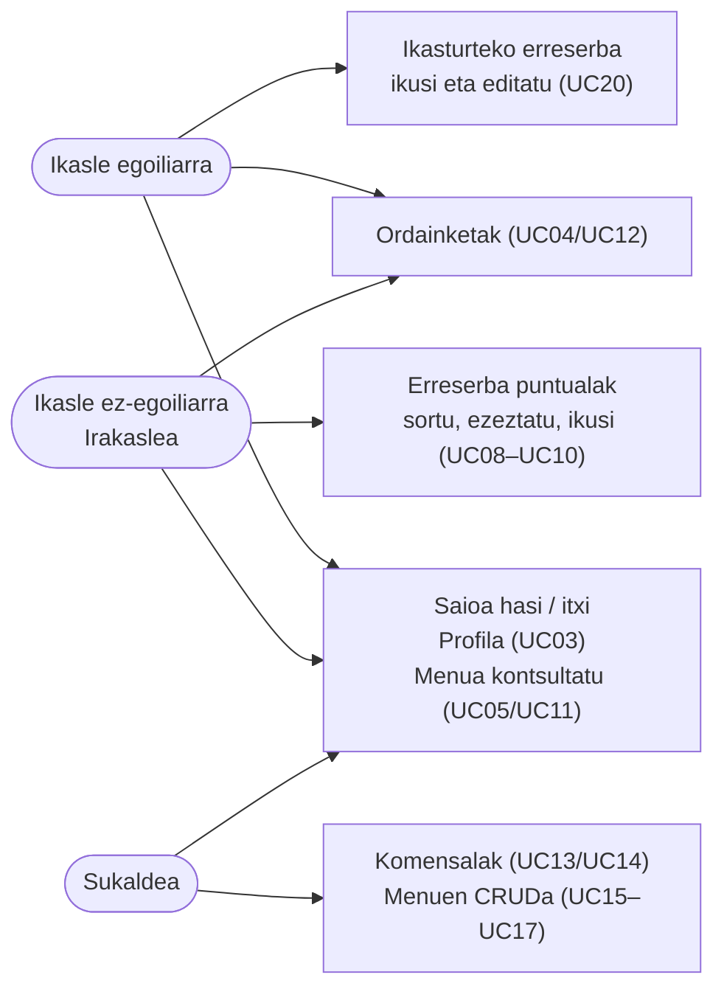

# Erabilera-kasuak

Web aplikazioaren erabilera-kasuak (UC01–UC20), rolaren arabera. Laravel-eko bertsiokoak dira,
eta migrazioan ez dira aldatu. Kasu bakoitzaren garapena GitHub-eko issue batean jarraitzen da.

## Ikuspegi orokorra

Sarbidea **rolaren** araberakoa da (`rola_behar` dekoratzailea). Ikasleen artean, `egoiliarra`-k
erabakitzen du erreserba mota: egoiliarrak ikasturteko erreserba du, eta ez-egoiliarrak erreserba puntualak egiten ditu (12. araua).

## Rol guztiak

| UC | Izena | Oharrak | Issue |
|---|---|---|---|
| UC03 | Profila ikusi | Orri bera rol guztientzat; menu beganoaren hobespena barne. Irakurketa soilik | [#15](https://github.com/lopezibon-dev/pyjangela/issues/15) |
| UC05 / UC11 | Menua kontsultatu | `/menua/`: datepicker-a + `fetch`. Menu estandarra eta beganoa. Sukaldeak ere bai | [#12](https://github.com/lopezibon-dev/pyjangela/issues/12) |

## Ikasle egoiliarrak (IKASLEA, `egoiliarra = true`)

| UC | Izena | Oharrak | Issue |
|---|---|---|---|
| UC01 / UC02 | Saioa hasi / itxi | IKASLEA dashboard-a kargatzen du | [#6](https://github.com/lopezibon-dev/pyjangela/issues/6) |
| UC04 | Ordainketak kontsultatu | Norberarenak soilik | [#15](https://github.com/lopezibon-dev/pyjangela/issues/15) |
| UC20 | Ikasturteko erreserba ikusi eta editatu | 10 boolear (egunak ∧ otorduak), eperik eta bertsiorik gabe. Ez badu, dena markatuta agertzen da eta gordetzean sortzen da | [#14](https://github.com/lopezibon-dev/pyjangela/issues/14) |

## Beste erabiltzaileak (IKASLEA ez-egoiliarra eta IRAKASLEA)

| UC | Izena | Oharrak | Issue |
|---|---|---|---|
| UC06 / UC07 | Saioa hasi / itxi | IKASLEA → IKASLEA dashboard-a; IRAKASLEA → bere dashboard-a | [#6](https://github.com/lopezibon-dev/pyjangela/issues/6) |
| UC08 | Erreserba sortu | Gutxienez 24 ordu lehenago; `ALDIZKAKOA` ordainketa sortzen du (`ORDAINTZEKE`) | [#13](https://github.com/lopezibon-dev/pyjangela/issues/13) |
| UC09 | Erreserba ezeztatu | 24 orduko epe bera; `EZEZTATUA` eta ordainketa ezabatu, transakzio batean | [#13](https://github.com/lopezibon-dev/pyjangela/issues/13) |
| UC10 | Nire erreserbak ikusi | Norberarenak soilik | [#13](https://github.com/lopezibon-dev/pyjangela/issues/13) |
| UC12 | Ordainketak kontsultatu | Norberarenak soilik | [#15](https://github.com/lopezibon-dev/pyjangela/issues/15) |

## Sukaldeko langileak (SUKALDEA)

| UC | Izena | Oharrak | Issue |
|---|---|---|---|
| UC18 / UC19 | Saioa hasi / itxi | SUKALDEA dashboard-a kargatzen du | [#6](https://github.com/lopezibon-dev/pyjangela/issues/6) |
| UC13 | Gaurko komensalak | Dashboard-ean (`/sukaldea/dashboard/`): guztira eta beganoak, otordu motaren arabera | [#16](https://github.com/lopezibon-dev/pyjangela/issues/16) |
| UC14 | Hurrengo egunetako estatistikak | `/sukaldea/estatistikak`, data-hautatzailearekin. UC13-ren kalkulu bera | [#16](https://github.com/lopezibon-dev/pyjangela/issues/16) |
| UC15 | Menua sortu | Deskribapen estandarra eta beganoa, biak derrigorrezkoak | [#11](https://github.com/lopezibon-dev/pyjangela/issues/11) |
| UC16 | Menua eguneratu | Berdin | [#11](https://github.com/lopezibon-dev/pyjangela/issues/11) |
| UC17 | Menua ezabatu | Berrespenarekin (POST) | [#11](https://github.com/lopezibon-dev/pyjangela/issues/11) |

## Komensalen kalkulua (UC13/UC14)

Egun eta otordu mota bakoitzeko komensalak =
**aplikatzen diren ikasturteko erreserbak** (eguna ∧ otorduak markatuta) +
**erreserba puntual aktiboak**. Erabiltzaile aktiboak soilik kontatzen dira, eta beganoen kopurua
`Erabiltzailea.beganoa`-tik ateratzen da (6. eta 18. arauak).
