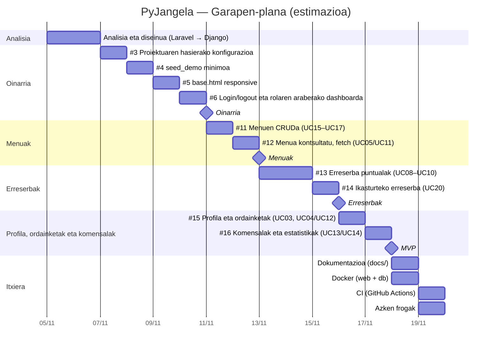

# PyJangela — Garapen-plana (Gantt)

Garapenaren denbora-estimazioa, milestone eta issue-en arabera antolatuta.
Estimazio bat da: ez du zertan bete. Garapenaren egoera GitHub Projects-eko issue-en egoeran jarraitzen da.

