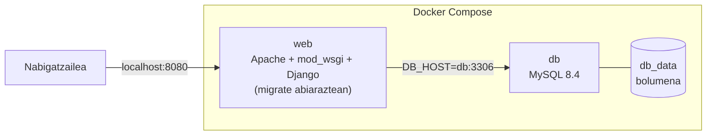

# Instalazioa

PyJangela bi modutan instala daiteke:

- **Instalazio klasikoa** (garapena): `runserver` eta MySQL lokala, `DEBUG=True`.
- **Docker bidezko instalazioa** (ekoizpena / MVP): Apache + mod_wsgi eta MySQL edukiontzietan, `DEBUG=False`.

Desberdintasuna: garapenean Django-ren `runserver`-ak zerbitzatzen du dena (estatikoak barne);
ekoizpenean Apache-k zerbitzatzen ditu Django (mod_wsgi bidez) eta `/static/` fitxategiak.

## 1. Instalazio klasikoa (Docker gabe)

Behar da: Git, Python 3.12 edo berriagoa eta MySQL 8.4.

1. Errepoa klonatu eta `web/` karpetan sartu:

   ```bash
   git clone https://github.com/lopezibon-dev/pyjangela.git
   cd pyjangela/web
   ```

2. Ingurune birtuala sortu eta aktibatu:

   ```bash
   python -m venv .venv
   .venv\Scripts\activate        # Windows
   # source .venv/bin/activate   # Linux / macOS
   ```

3. Mendekotasunak instalatu:

   ```bash
   pip install -r requirements.txt
   ```

4. MySQL-en datu-basea eta erabiltzailea sortu (`mysql -u root -p`):

   ```sql
   CREATE DATABASE jangela CHARACTER SET utf8mb4 COLLATE utf8mb4_unicode_ci;
   CREATE USER 'jangela'@'localhost' IDENTIFIED BY 'jangela_pass';
   GRANT ALL PRIVILEGES ON jangela.* TO 'jangela'@'localhost';
   FLUSH PRIVILEGES;
   ```

5. `.env` sortu `.env.example`-tik abiatuta eta bete:

   ```bash
   copy .env.example .env        # Windows
   # cp .env.example .env        # Linux / macOS
   ```

   ```ini
   SECRET_KEY=gako-luze-eta-ausazko-bat
   DEBUG=True
   ALLOWED_HOSTS=
   DB_HOST=localhost
   DB_PORT=3306
   DB_NAME=jangela
   DB_USER=jangela
   DB_PASSWORD=jangela_pass
   ```

6. Migrazioak aplikatu eta demo-datuak sortu:

   ```bash
   python manage.py migrate
   python manage.py seed_demo
   ```

7. Zerbitzaria abiarazi:

   ```bash
   python manage.py runserver
   ```

8. Ireki <http://localhost:8000> eta hasi saioa demo-erabiltzaile batekin
   (adibidez `david@jangela.eus`, pasahitza `1234`).

## 2. Docker bidezko instalazioa

Behar da: Git eta Docker (Docker Compose v2-rekin, adibidez Docker Desktop).



1. Errepoa klonatu:

   ```bash
   git clone https://github.com/lopezibon-dev/pyjangela.git
   cd pyjangela
   ```

2. Errepoaren erroan `.env.docker` fitxategia sortu (ez da Git-era igotzen).
   Bi edukiontziek erabiltzen dute; `DB_*` eta `MYSQL_*` balioek bat etorri behar dute:

   ```ini
   SECRET_KEY=gako-luze-eta-ausazko-bat
   DEBUG=False
   ALLOWED_HOSTS=localhost,127.0.0.1
   DB_HOST=db
   DB_PORT=3306
   DB_NAME=jangela
   DB_USER=jangela
   DB_PASSWORD=jangela_pass
   MYSQL_ROOT_PASSWORD=root_pass
   MYSQL_DATABASE=jangela
   MYSQL_USER=jangela
   MYSQL_PASSWORD=jangela_pass
   ```

3. Irudia eraiki eta edukiontziak abiarazi (lehen aldian minutu batzuk behar ditu):

   ```bash
   docker compose up --build
   ```

   `web` edukiontzia `db` prest dagoenean abiarazten da eta `migrate` automatikoki exekutatzen du.
   Fitxategi estatikoak irudia eraikitzean biltzen dira (`collectstatic`).
   Itxaron log-etan `Applying sessions.0001_initial... OK` (azken migrazioa) agertu arte.

4. Beste terminal batean, demo-datuak sortu (eskuz; datuak ezabatu eta berriro sortzen ditu):

   ```bash
   docker compose exec web python manage.py seed_demo
   ```

5. Ireki <http://localhost:8080> eta hasi saioa demo-erabiltzaile batekin
   (adibidez `david@jangela.eus`, pasahitza `1234`).

6. Gelditu edo dena ezabatu (`Ctrl+C` 3. urratseko terminalean, eta gero):

   ```bash
   docker compose down        # edukiontziak ezabatu (datuak bolumenean geratzen dira)
   docker compose down -v     # gelditu eta datu-basearen bolumena ere ezabatu
   ```

### Eguneratu (kodea aldatu ondoren)

1. Kode berria ekarri:

   ```bash
   git pull
   ```

2. Irudia berreraiki eta abiarazi:

   ```bash
   docker compose up --build
   ```

   Horrek fitxategi estatikoak berriro biltzen ditu eta, abiaraztean, migrazio berriak aplikatzen ditu.
   Datu-baseko datuak mantentzen dira.

`seed_demo` ez da automatikoki exekutatzen: datuak ezabatzen dituenez, eskuz exekutatu behar da (4. urratsa).
