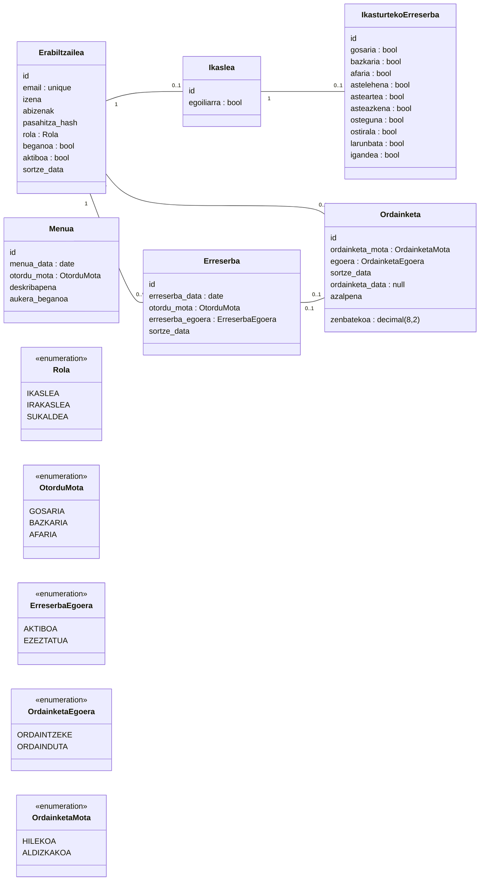

# Domeinuaren UML diagrama

Sei entitate eta bost enumerazio. ORM ereduak dira entitateak (ez dago domeinuko klase bereizirik).
Ereduak [`web/jangela/infrastructure/persistence/models/`](../web/jangela/infrastructure/persistence/models/)-n daude,
eta enumak [`web/jangela/domain/enums/`](../web/jangela/domain/enums/)-n.

## Klase-diagrama

`Menua`-k ez du erlazio zuzenik: data eta otordu motaren bidez lotzen da erreserbekin.
Enumen erabilera atributuaren motan adierazten da (`rola : Rola`), diagrama ez kargatzeko.

## Erlazioak eta Django

| Erlazioa | Django | Oharra |
|---|---|---|
| Erabiltzailea – Ikaslea | `OneToOneField` | IKASLEA rola dutenek bakarrik (3. araua) |
| Ikaslea – IkasturtekoErreserba | `OneToOneField` | Egoiliarrek bakarrik (4. araua) |
| Erabiltzailea – Erreserba | `ForeignKey` | Erreserba puntualak |
| Erabiltzailea – Ordainketa | `ForeignKey` | Ordainketa oro erabiltzaile batena da (7. araua) |
| Erreserba – Ordainketa | `OneToOneField`, `null=True` | `ALDIZKAKOA` → erreserba bai; `HILEKOA` → `NULL` (8. araua) |

Erlazio guztietan `on_delete=PROTECT`: ezin da ezabatu menpeko datuak dituen erregistrorik.

## Erabiltzailea eta Django

`Erabiltzailea` Django-ren `AbstractUser`-etik dator (`AUTH_USER_MODEL`), eta saioa **emailarekin** hasten da.
Diagramako izenak Django-ren eremu hauei dagozkie:

| Domeinua | Django |
|---|---|
| `izena` | `first_name` |
| `abizenak` | `last_name` |
| `aktiboa` | `is_active` |
| `sortze_data` | `date_joined` |
| `pasahitza_hash` | `password` |

`is_staff` / `is_superuser` eta `rola` ardatz independenteak dira: superuser-a kontu teknikoa da
(`/admin/` soilik), eta ez dago `ADMIN` rolik.

## Arauak ereduan

Arau batzuk datu-basean bertan bermatzen dira (azken babesa):

| Araua | Non |
|---|---|
| 1. Email bakarra | `EmailField(unique=True)` |
| 8. `ALDIZKAKOA` ↔ erreserba | `CheckConstraint` (`Ordainketa`) |
| 9. `ORDAINDUTA` ↔ ordainketa-data | `CheckConstraint` (`Ordainketa`) |
| 11. Menu bakarra data + otordu mota bakoitzeko | `UniqueConstraint` (`Menua`) |
| 22. Erreserba aktibo bakarra data + otordu mota bakoitzeko | `UniqueConstraint` (`Erreserba`) — *egiteke* ([#13](https://github.com/lopezibon-dev/pyjangela/issues/13)) |

Gainerako arauak zerbitzuetan egiaztatzen dira ([arkitektura.md](arkitektura.md#non-balidatzen-da-zer)).
